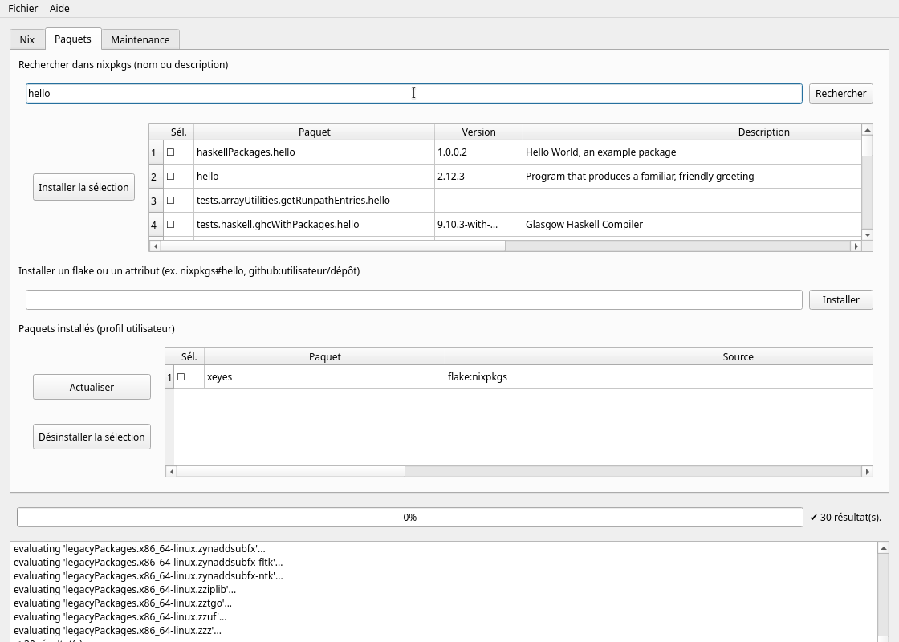

# Nix Manager

Gestionnaire graphique (Qt6) de **Nix** sur une distribution non-NixOS (testé
sur Solus). Il installe et désinstalle Nix lui-même, puis gère les paquets de
votre profil utilisateur : recherche dans nixpkgs, installation d'un paquet ou
d'un flake, liste, mise à jour, nettoyage.

Ce n'est **pas** un convertisseur de paquets : aucun rapport avec
`.deb` / `.rpm` / `.eopkg`. Les paquets installés par Nix restent gérés par Nix.



## Fonctionnalités

- **Onglet Nix** — état détecté : version, `nix-daemon` actif, mode
  d'installation (multi-utilisateur ou mono-utilisateur), chemin du profil,
  espace occupé par `/nix` (barre), disponibilité du bac à sable, applications
  présentes au menu, position du `PATH`.
- **Installer Nix** — télécharge l'installeur officiel puis l'exécute en mode
  démon multi-utilisateur via `pkexec` (mot de passe administrateur), journalise
  la sortie en direct et vérifie à la fin que `nix-daemon` tourne et que
  `nix --version` répond.
- **Désinstaller Nix** — confirmation explicite (tous les paquets Nix seront
  perdus), puis `/nix/nix-installer uninstall` si l'outil officiel existe, sinon
  procédure manuelle documentée (arrêt/désactivation du service, unités
  systemd, `/nix`, utilisateurs et groupe `nixbld`, entrées `/etc/profile.d`,
  blocs Nix de `/etc/bashrc` et `/etc/zshrc`, `/etc/sudoers.d/nix*`, `/etc/nix`),
  suivie du nettoyage des restes du compte (`~/.nix-profile`, `~/.nix-defexpr`,
  `~/.cache/nix`, `~/.local/state/nix`, `environment.d`, liens `.desktop`).
- **Onglet Paquets** — recherche `nix search nixpkgs <terme> --json` (nom,
  version, description), classée par pertinence et lancée au clic **ou avec la
  touche Entrée**. Une case à cocher en tête de chaque ligne permet de
  sélectionner **plusieurs** paquets, y compris **à travers plusieurs
  recherches** (la sélection est conservée et ré-affichée quand un résultat
  revient) : installation en lot depuis les résultats, désinstallation en lot
  depuis le profil. Les boutons d'action sont
  placés à gauche des tableaux pour laisser toute la hauteur aux listes.
  Installation d'un flake arbitraire (`nixpkgs#hello`,
  `github:utilisateur/dépôt`, chemin local) et liste du profil
  (`nix profile list --json`).
- **Onglet Maintenance** — `nix profile upgrade --all`,
  `nix-collect-garbage -d` (avec confirmation), intégration des applications au
  menu, repli « compilations sans bac à sable » (`sandbox = false`), et
  **autorisation des paquets non libres** (`discord`, `steam`, … : écrit
  `~/.config/nixpkgs/config.nix` et passe `NIXPKGS_ALLOW_UNFREE=1` + `--impure`
  aux installations).
- **Sous-volume `/nix`** — boutons « Créer » / « Supprimer le sous-volume /nix »
  (root via `pkexec`) : un sous-volume btrfs dédié sort le magasin des
  instantanés de `/`, avec confirmation explicite avant toute suppression.
- **Entrées de menu automatiques** — après chaque installation ou
  désinstallation, les `.desktop` du profil sont réécrits (`Exec`/`Icon`
  absolus) sans avoir à cliquer sur un bouton.
- **Compatibilité `/etc/zoneinfo`** — lors de l'installation de Nix, le lien
  `/etc/zoneinfo → /usr/share/zoneinfo` est créé automatiquement (Heroic, Steam,
  Lutris et les autres applications empaquetées en environnement FHS montent ce
  chemin dans leur bac à sable et échouent sans lui : `bwrap: Can't find source
  path /etc/zoneinfo`). Si Nix était déjà installé avant cette version :
  `sudo ln -s /usr/share/zoneinfo /etc/zoneinfo`.
- **Journal** — chaque commande et sa sortie sont affichées en direct ; les
  boutons sont désactivés pendant une opération ; la fenêtre ne gèle jamais
  (thread de travail + canal + `QTimer`).
- Interface en **français et anglais**, selon la locale (surcharge :
  `NIX_MANAGER_LANG=fr` ou `en`).

## Installation (Solus)

```sh
sudo eopkg install https://github.com/Julien684/nix-manager/releases/download/v0.1.7/nix-manager-0.1.7-8-1-x86_64.eopkg
```

Dépendance runtime unique : `qt6-base-gui` (fourni par tout bureau Solus).

Le dépôt binaire personnel :

```sh
sudo eopkg add-repo linuxon https://raw.githubusercontent.com/Julien684/eopkg-repo/main/eopkg-index.xml
sudo eopkg update-repo
sudo eopkg install nix-manager
```

## Utilisation

1. Onglet **Nix** : vérifiez l'état, puis « Installer Nix » (mot de passe
   administrateur demandé par `pkexec`). L'installateur officiel crée le groupe
   et les utilisateurs `nixbld`, le magasin `/nix` et le service `nix-daemon`.
2. Onglet **Paquets** : cherchez (le premier appel télécharge nixpkgs, plusieurs
   minutes ; les suivants sont rapides), sélectionnez une ligne puis
   « Installer la sélection ». Les paquets vont dans **votre** profil, sans root.
3. Onglet **Maintenance** : « Intégrer les applications au menu » réécrit chaque
   `.desktop` du profil dans `~/.local/share/applications` avec `Exec=` et
   `Icon=` en **chemins absolus du magasin** (les entrées se lancent et
   s'affichent donc immédiatement, sans reconnexion ni `PATH` particulier), et
   écrit `~/.config/environment.d/60-nix-xdg.conf` (`XDG_DATA_DIRS` + `PATH`)
   pour les icônes et les thèmes des applications lancées depuis un terminal.

Ligne de commande utile pour le diagnostic :

```sh
nix-manager --status
```

## Points d'attention

- **`/nix` est volumineux.** Placez-le sur un sous-volume btrfs dédié, **exclu
  des instantanés** : photographier le magasin coûte des dizaines de Go et le
  restaurer ne restaure aucun paquet utilisable.
- **`PATH`** : pour que la version Nix d'un outil l'emporte sur celle de la
  distribution, `~/.nix-profile/bin` et `/nix/var/nix/profiles/default/bin`
  doivent précéder `/usr/bin`.
- **Bac à sable** : si le noyau restreint les *user namespaces*, les
  compilations locales échouent. Le bouton « Autoriser les compilations sans bac
  à sable » écrit `sandbox = false` dans `/etc/nix/nix.conf` et redémarre
  `nix-daemon` ; le cache binaire reste utilisable. Nix Manager ne modifie jamais
  ce fichier sans confirmation.
- **Discover et eopkg ignorent les paquets Nix** : ils ne les listent pas, ne les
  mettent pas à jour et ne les désinstallent pas. Les mises à jour passent par
  Nix (`nix profile upgrade`).
- `pkexec` a besoin d'un agent d'authentification (Polkit) : il fonctionne dans
  une session de bureau, pas dans une session SSH sans agent.
- Nix utilise des *user namespaces* : sur un noyau qui les interdit
  (`kernel.unprivileged_userns_clone=0`), seules les installations depuis le
  cache binaire fonctionnent, sauf repli `sandbox = false`.

## Développement

```sh
cargo build --release     # binaire unique : target/release/nix-manager
cargo test                # parseurs et logique pure (sans Qt)
QT_QPA_PLATFORM=offscreen NIX_MANAGER_SMOKE_MS=1500 ./target/release/nix-manager
python3 build_eopkg.py . .   # construit le .eopkg
```

Architecture : `src/nix.rs` (détection, commandes, parseurs purs),
`src/job.rs` (threads de travail et messages), `src/main.rs` (interface),
`src/i18n.rs` (textes FR/EN).

## Licence

GPL-3.0-or-later. Projet non officiel, sans lien avec l'équipe NixOS.

---

# Nix Manager (English)

A Qt6 graphical manager for **Nix** on a non-NixOS distribution (tested on
Solus). It installs and removes Nix itself, then manages your user profile:
search nixpkgs, install a package or a flake, list, upgrade and clean up.

This is **not** a package converter: it has nothing to do with
`.deb` / `.rpm` / `.eopkg`, and packages installed by Nix stay managed by Nix.

## Features

- **Nix tab** — detected state: version, `nix-daemon` activity, install mode
  (multi-user or single-user), profile path, space used by `/nix` (gauge),
  sandbox availability, menu entries, `PATH` position.
- **Install Nix** — downloads the official installer and runs it in multi-user
  daemon mode through `pkexec`, streams the output into the journal and verifies
  that `nix-daemon` is running and `nix --version` answers.
- **Uninstall Nix** — explicit confirmation (every Nix package is lost), then
  `/nix/nix-installer uninstall` when the official uninstaller is present,
  otherwise a documented manual procedure (stop/disable the service, systemd
  units, `/nix`, `nixbld` users and group, `/etc/profile.d` entries, Nix blocks
  in `/etc/bashrc` and `/etc/zshrc`, `/etc/sudoers.d/nix*`, `/etc/nix`), followed
  by the user-level leftovers (`~/.nix-profile`, `~/.nix-defexpr`,
  `~/.cache/nix`, `~/.local/state/nix`, `environment.d`, `.desktop` links).
- **Packages tab** — search through `nix search nixpkgs <term> --json` (name,
  version, description), ranked by relevance and started with the **Enter key**
  or the button. A checkbox leads every row, so **several** packages can be
  installed at once from the results — **across several searches**, since the
  selection is kept and re-ticked when a result comes back — and uninstalled at
  once from the profile;
  action buttons sit left of the tables to give the lists full height. Install
  an arbitrary flake (`nixpkgs#hello`, `github:user/repo`, local path) and list
  the profile (`nix profile list --json`).
- **Maintenance tab** — `nix profile upgrade --all`, `nix-collect-garbage -d`
  (with confirmation), desktop integration, the "builds without sandbox"
  fallback (`sandbox = false`), and **unfree package support** (`discord`,
  `steam`, …: writes `~/.config/nixpkgs/config.nix` and passes
  `NIXPKGS_ALLOW_UNFREE=1` + `--impure` to installs).
- **`/nix` subvolume** — "Create" / "Delete the /nix subvolume" buttons (root
  via `pkexec`): a dedicated btrfs subvolume keeps the store out of `/`
  snapshots, with an explicit confirmation before any deletion.
- **Automatic menu entries** — after every install or removal the profile's
  `.desktop` files are rewritten (`Exec`/`Icon` as absolute paths) without any
  extra click.
- **`/etc/zoneinfo` compatibility** — installing Nix now creates the
  `/etc/zoneinfo → /usr/share/zoneinfo` link automatically (Heroic, Steam,
  Lutris and other FHS-packaged apps bind that path inside their sandbox and
  fail without it: `bwrap: Can't find source path /etc/zoneinfo`). If Nix was
  already installed before this version: `sudo ln -s /usr/share/zoneinfo
  /etc/zoneinfo`.
- **Journal** — every command and its output are streamed live; controls are
  disabled while an operation runs; the window never freezes (worker thread +
  channel + `QTimer`).
- User interface in **French and English**, following the locale (override with
  `NIX_MANAGER_LANG=fr` or `en`).

## Installation (Solus)

```sh
sudo eopkg install https://github.com/Julien684/nix-manager/releases/download/v0.1.7/nix-manager-0.1.7-8-1-x86_64.eopkg
```

Single runtime dependency: `qt6-base-gui` (shipped by every Solus desktop).

Personal binary repository:

```sh
sudo eopkg add-repo linuxon https://raw.githubusercontent.com/Julien684/eopkg-repo/main/eopkg-index.xml
sudo eopkg update-repo
sudo eopkg install nix-manager
```

## Usage

1. **Nix** tab: check the state, then "Install Nix" (`pkexec` asks for the
   administrator password). The official installer creates the `nixbld` group
   and users, the `/nix` store and the `nix-daemon` service.
2. **Packages** tab: search (the first call downloads nixpkgs — several minutes;
   later searches are fast), select a row and "Install selection". Packages go
   into **your** profile, without root.
3. **Maintenance** tab: "Integrate menu entries" rewrites each profile
   `.desktop` into `~/.local/share/applications` with `Exec=` and `Icon=` as
   **absolute store paths** (entries launch and display immediately, with no
   re-login and no particular `PATH`), and writes
   `~/.config/environment.d/60-nix-xdg.conf` (`XDG_DATA_DIRS` + `PATH`) for
   icons and themes of apps started from a terminal.

Diagnostic command line:

```sh
nix-manager --status
```

## Caveats

- **`/nix` is large.** Put it on a dedicated btrfs subvolume **excluded from
  snapshots**: snapshotting the store costs tens of gigabytes and restoring it
  restores no usable package.
- **`PATH`**: for Nix's copy of a tool to win, `~/.nix-profile/bin` and
  `/nix/var/nix/profiles/default/bin` must come before `/usr/bin`.
- **Sandbox**: if the kernel restricts *user namespaces*, local builds fail. The
  "Allow builds without sandbox" button writes `sandbox = false` to
  `/etc/nix/nix.conf` and restarts `nix-daemon`; the binary cache stays usable.
  Nix Manager never edits that file without confirmation.
- **Discover and eopkg ignore Nix packages**: they neither list, update nor
  remove them. Updates go through Nix (`nix profile upgrade`).
- `pkexec` needs a Polkit authentication agent: it works in a desktop session,
  not in an SSH session without one.

## Development

```sh
cargo build --release     # single binary: target/release/nix-manager
cargo test                # pure parsers and logic (no Qt)
QT_QPA_PLATFORM=offscreen NIX_MANAGER_SMOKE_MS=1500 ./target/release/nix-manager
python3 build_eopkg.py . .   # builds the .eopkg
```

Layout: `src/nix.rs` (detection, commands, pure parsers), `src/job.rs` (worker
threads and messages), `src/main.rs` (UI), `src/i18n.rs` (FR/EN strings).

## License

GPL-3.0-or-later. Unofficial project, not affiliated with the NixOS team.
